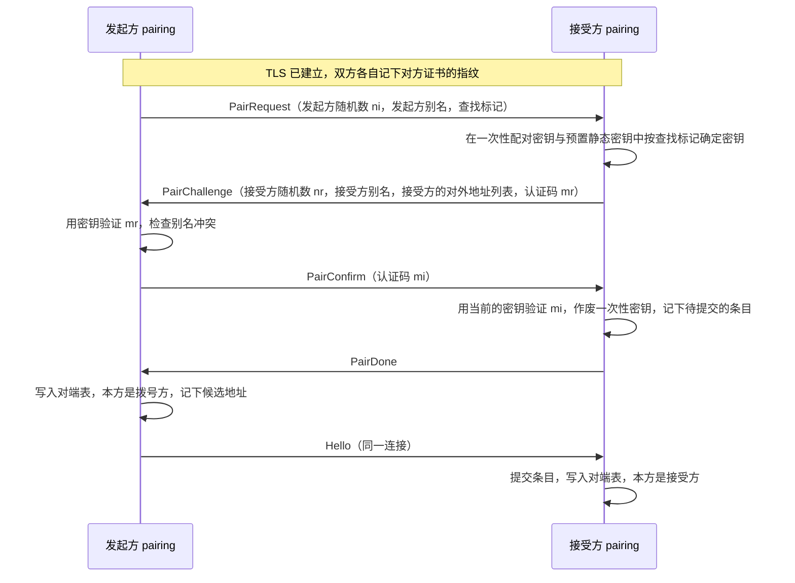

# pairing

`pairing` 负责确认另一个 [Broker](../../glossary.md) 的身份并决定是否把它当作对端。它持有本 Broker 的身份密钥与证书，保存对端表，生成和核验配对密钥，执行把一个陌生 Broker 变成对端的握手，记下本方在每对对端中的角色，并管理每个对端的别名与候选地址。握手之后的每次连接只核对指纹，不再涉及密钥。可以把它看作一份只能由用户亲手添加条目的指纹名单。

## 核心概念

系统里没有证书颁发机构，每个 Broker 的证书都是自签的。TLS 本身只能保证“连接的另一端持有这张证书的私钥”，不能说明那一端是不是用户想连的 Broker。配对握手补上这一步（[ADR-pairing-key-trust](../../adr/adr-pairing-key-trust.md)）：双方用配对密钥各自对“自己的指纹加上自己在本次 TLS 连接中看到的对方指纹”求消息认证码并互相出示。中间人若把连接拆成两段并分别出示自己的证书，双方看到的对方指纹就与本方在认证码中使用的对方指纹不同，认证码对不上；中间人不知道密钥，也无法重算。

握手成功后信任转移到指纹上，密钥此后是否作废都不影响已有的对端。

指纹是身份，别名只是显示名，而 Agent 地址用的是别名。同一个别名若能指向两个 Broker，地址就会指错对象。本包因此为每个对端维护一个生效别名，并保证本机别名与全部对端的生效别名互不相同：对方自报的别名与已有的冲突时，用本地别名把它区分开。

配对还决定这对对端今后由谁来连。下文把配对握手中凭地址和配对密钥发起配对的一方称为发起方，持有该密钥、接受配对的一方称为接受方；配对完成后，发起方是拨号方，接受方仍是接受方（[ADR-initiator-redials](../../adr/adr-initiator-redials.md)）。本包把角色记在对端表中，只为本方是拨号方的对端保存候选地址，即拨号时依次尝试的地址，供 [link](design-link.md) 拨号；接受方在握手应答中把自己的对外地址列表告诉发起方，发起方不报告自己的地址。

## 职责

- 首次启动时生成身份密钥与自签证书并保存，此后每次启动加载同一份，使指纹保持不变（`REQ-broker-pairing-001`）。
- 生成一次性配对密钥，并在结果中另附供展示的本机地址；在密钥过期、成功使用一次或验证失败次数达到上限时作废密钥（`REQ-broker-pairing-005` 至 `REQ-broker-pairing-007`、`REQ-broker-pairing-028`）。
- 配置了预置静态密钥时，接受凭它进行的配对；不生成、不保存预置静态密钥（[ADR-static-pairing-key](../../adr/adr-static-pairing-key.md)，`REQ-broker-pairing-008`、`REQ-broker-pairing-009`、`REQ-broker-pairing-025`）。
- 作为发起方或接受方执行配对握手，成功后把对方写入对端表并记下本方的角色：发起方是拨号方，接受方是接受方；同一对 Broker 重新配对时，角色按新的发起方重新确定（[ADR-initiator-redials](../../adr/adr-initiator-redials.md)，`REQ-broker-pairing-010` 至 `REQ-broker-pairing-012`、`REQ-broker-pairing-027`）。
- 持久保存对端表，使配对之后的连接只凭指纹认证，Broker 重启后配对关系仍在（`REQ-broker-pairing-016`、`REQ-broker-pairing-017`）。
- 为本方是拨号方的对端保存候选地址及其来源和上一次连通的地址，按发起配对时给出的地址、接受方告知的对外地址列表和该对端名片中的列表更新（[ADR-advertised-address](../../adr/adr-advertised-address.md)）。
- 维护别名：发起配对时别名冲突的要求调用方提供本地别名；接受配对时发生冲突的，以及对方自报的别名日后变更而发生冲突的，自行生成本地别名（`REQ-broker-pairing-004`、`REQ-broker-pairing-024`、`REQ-broker-pairing-026`）。
- 限制配对尝试的频率，使配对密钥不能被逐个试出。
- 解除配对时从对端表删除条目，并经注入的接口关闭链路（`REQ-broker-pairing-021`）。
- 为 `link` 提供 TLS 配置、“指纹是否为对端”与“本方是什么角色”的查询以及候选地址，为 [directory](design-directory.md) 提供签名与验签。

### 非职责

- 不建立和维护链路，由 `link` 负责。握手所用的连接由 `link` 建立后交来。
- 不决定是否发起配对。每次配对由一次明确的调用触发（`REQ-broker-pairing-014`），调用来自 [broker](design-broker.md)。
- 不查名录。握手得到的指纹与名片所载指纹的比对由 `broker` 完成。
- 不传递配对密钥与地址。它们由用户经系统之外的途径交给对方。
- 不判定调用方有没有权限生成配对密钥、发起配对或解除配对，由 `broker` 在调用本包之前按调用方账户对配置文件的写权限判定（[ADR-management-by-config-file-permission](../../adr/adr-management-by-config-file-permission.md)，`REQ-broker-config-021`）。
- 不决定本机默认别名的取法，不计算本机的对外地址列表，不校验、不读写预置静态密钥的配置项，由 [config](design-config.md) 负责；本包只在握手时取用预置静态密钥的取值。

## 外部接口契约

供 `broker`、`link`、`directory` 调用，签名稳定。

```go
func Fingerprint() Fingerprint
func TLSConfig() *tls.Config            // 出示本机证书；握手阶段接受任意对方证书，指纹在握手后核对
func IsPeer(fp Fingerprint) bool
func Role(fp Fingerprint) Role          // 本方在这对对端中的角色：Dialer 或 Acceptor
func Peers() []Peer
func EffectiveAlias(fp Fingerprint) string
func ResolveAlias(alias string) (Fingerprint, bool)

// CreateOneTimeKey 是唯一生成配对密钥的接口；shown 是供展示的本机地址，没有可展示的地址时为空。
func CreateOneTimeKey() (key string, expires time.Time, shown []string, err error)
// Connect 凭对方的地址与配对密钥发起配对；shownHost 是 address 中的主机名，只供展示。
func Connect(ctx context.Context, address, key, localAlias string) (p Peer, shownHost string, err error)
func Accept(conn PairConn) error        // 由 link 在首帧为 PairRequest 时调用
func Unpair(fp Fingerprint) error

func ObserveAlias(fp Fingerprint, alias string)                  // 由 link 在收到 Hello 或 PeerInfo 时调用
func ObserveAcceptorAddresses(fp Fingerprint, addresses []string) // 由 link 在本方是拨号方、收到接受方的 Hello 或 PeerInfo 时调用
func ObserveConnected(fp Fingerprint, address string)            // 由 link 在拨号连通、链路建立后调用
func UpdateCardAddresses(fp Fingerprint, addresses []string)     // 由 broker 在接受对端的名片时调用
func Candidates(fp Fingerprint) (addresses []string, last string) // 供 link 拨号；本方是接受方时为空

func Sign(data []byte) []byte
func Verify(pub, data, sig []byte) bool
func FingerprintOf(pub []byte) Fingerprint

// Transport 由 broker 在装配时注入，其实现在 link 包。
type Transport interface {
    PairDial(ctx context.Context, address string, run func(PairConn) error) error
    Drop(fp Fingerprint)
}
```

一次性配对密钥是系统生成的 80 位随机数，编码为 16 个字符，每 4 个一组以 `-` 分隔，字母表取 Crockford Base32 的 `0123456789ABCDEFGHJKMNPQRSTVWXYZ`（[REF-crockford-base32](../../references.md)），例如 `K7QF-2M9X-HT4C-PWZ3`。预置静态密钥是配置项 `pairing.static_key` 的取值，长度 16 至 128 个字符。两种密钥在握手中都按原样使用，区分大小写；预置静态密钥不套用一次性配对密钥的分组格式与字母表。

`CreateOneTimeKey` 的 `shown` 是本机对外地址列表中每一项的展示写法，首项在前，形如 `buildbox(192.168.1.10:17443)` 或 `buildbox([2001:db8::1]:17443)`：括号外是 `config` 给出的系统主机名，括号里是对外地址列表中的一项。展示不是密钥的一部分，也不与密钥绑定（`REQ-broker-pairing-028`）。

`Connect` 的 `address` 有两种写法：`地址:端口`，或接受方生成密钥时展示的 `主机名(地址:端口)`。后一种写法只取括号里的部分用于拨号；主机名部分被读取后只作为 `shownHost` 交回调用方展示，不用于拨号，不参与身份的判定，也不记入候选地址。地址是 IP 地址或域名，IPv6 地址带方括号，端口不可省略。

别名由字母、数字、`.`、`-`、`_` 组成，长度 1 至 24，本地别名同样如此（`REQ-broker-pairing-037`）。本机自报的别名取自 `config`：配置了 `broker.alias` 时取它，否则是按监听地址得出的默认别名，有监听地址时形如 `buildbox-17443`（`REQ-broker-pairing-002`）。

## 依赖

`pairing` 引用 `config`，用来读取别名、系统主机名、本方的对外地址列表、预置静态密钥、数据目录的位置和各项限制，并把配对与别名事件交给它写入审计日志。它不引用 `link`：发起握手所需的拨号和解除配对所需的关闭链路，经 `Transport` 接口由 `broker` 注入；`link` 引用本包，方向与模块依赖图一致。

## UML 图

下图是一次配对握手。`PairRequest` 中的查找标记是由配对密钥与本次随机数算出的短值，接受方据此找出发起方用的是哪个密钥，算式见核心数据结构。发起方在收到 `PairDone` 后写入对端表；接受方验证通过后先把对方记为待提交的条目，在同一连接上收到发起方的首个 `Hello` 时才写入对端表。只有接受方的应答带对外地址列表，发起方不报告自己的地址。



## 核心数据结构

| 结构 | 内容 | 存放 |
|---|---|---|
| 身份 | Ed25519 私钥与自签证书，证书不含主机名 | 数据目录内的 `identity.key`、`identity.crt` |
| 对端表 | 每个对端的指纹、公钥、对方自报的别名、本地别名、本方的角色、配对时间；本方是拨号方的，另有候选地址及其来源和上一次连通的地址 | 数据目录内的 `peers.json` |
| 一次性配对密钥表 | 密钥、生成时间、验证失败次数 | 仅内存 |
| 配对尝试计数 | 当前这一分钟内既没有匹配上一次性配对密钥、也没有匹配上预置静态密钥的请求数 | 仅内存 |
| 待提交的条目 | 接受方已验证、尚未收到发起方 `Hello` 的对方信息 | 仅内存，随握手所在的连接存续 |

数据目录的位置由 `config` 按部署形态给出。同一主机上的每个 Broker 实例各有自己的数据目录，因而各有自己的身份与对端表。指纹是证书公钥信息的 SHA-256，显示时取十六进制；监听地址与对外地址都不参与身份的判定。对端的生效别名是它的本地别名，没有本地别名时是它自报的别名。预置静态密钥不在数据目录中，只在配置文件里。

候选地址按来源分别保存，每个来源只保留最近一次给出的列表，每个列表至多 8 项：`acceptor` 是接受方在 `PairChallenge`、`Hello` 或 `PeerInfo` 中告知的对外地址列表；`card` 是该对端名片所载的列表；`pairing` 是发起配对时拨通的地址。候选地址只含本版本认识的地址项：`acceptor` 与 `card` 两个来源的列表中种类不认识的项在记入时跳过，不保存，也不用于拨号，列表中其余的项照常记入（[ADR-advertised-address](../../adr/adr-advertised-address.md)）。`Candidates` 返回按 `acceptor`、`card`、`pairing` 的顺序合并去重后的列表，以及上一次连通的地址。本方是接受方的对端不保存候选地址；重新配对使本方成为接受方时，原有的候选地址随之删除。

认证码与查找标记的计算，`‖` 表示拼接：

```
标记 = HMAC-SHA256(密钥, "agent-peer pair hint" ‖ ni) 的前 8 个字节
mr   = HMAC-SHA256(密钥, "agent-peer pair responder" ‖ ni ‖ nr ‖ 接受方指纹 ‖ 接受方看到的发起方指纹)
mi   = HMAC-SHA256(密钥, "agent-peer pair initiator" ‖ ni ‖ nr ‖ 发起方指纹 ‖ 发起方看到的接受方指纹)
```

每一方验证时，把对方算式里的两个指纹换成自己视角下的值：自己看到的对方指纹，以及自己的指纹。连接在中途被拆成出示不同证书的两段时，两个视角不一致，验证失败。两个认证码的标签不同，一方的认证码不能充当另一方的。

## 核心算法与流程

### 走查

Broker A 按默认配置监听全部地址，系统主机名是 `hostA`，默认路由所在接口的地址是 `192.0.2.10`，对外地址列表只有 `192.0.2.10:17443`；Broker B 位于 NAT 之后，A 连不到 B。A 的用户生成一次性配对密钥，把展示的地址和密钥交给 B 的用户，B 的用户凭它们发起配对。

| 步骤 | 事件 | A 的密钥表 | A 的对端表 | B 的对端表 |
|---|---|---|---|---|
| 1 | A 调用 `CreateOneTimeKey`，得到密钥 `K7QF-2M9X-HT4C-PWZ3`，展示 `hostA(192.0.2.10:17443)` | `K7QF…`，失败 0 次 | 空 | 空 |
| 2 | B 调用 `Connect`，`address` 为 `hostA(192.0.2.10:17443)`，取括号里的地址经注入的 `PairDial` 建立 TLS | 不变 | 空 | 空 |
| 3 | B 发 `PairRequest`；A 按查找标记找到 `K7QF…`，计算 `mr`，回 `PairChallenge`，带对外地址列表 `192.0.2.10:17443` | 不变 | 空 | 空 |
| 4 | B 验证 `mr` 通过，别名无冲突，发 `PairConfirm` | 不变 | 空 | 空 |
| 5 | A 验证 `mi` 通过，删除密钥，把 B 记为待提交 | 空 | 空，B 待提交 | 空 |
| 6 | A 回 `PairDone`，B 写入 A | 空 | 空，B 待提交 | A，本方是拨号方；候选地址 `192.0.2.10:17443`，来源 `acceptor` 与 `pairing`；上一次连通的也是它 |
| 7 | B 在同一连接上发 `Hello`；A 收到后提交 B，连接转为链路 | 空 | B，本方是接受方 | A |

`hostA` 只作为 `shownHost` 出现在 B 的配对结果中，供 B 的用户核对，不进入 B 的对端表。A 没有记下 B 的任何地址，链路断开后只由 B 重新连入；B 在 `Hello` 中不报告自己的地址。A 在第 7 步的 `Hello` 中再次给出对外地址列表，与 `PairChallenge` 中的相同，B 的候选地址不变。

A 收到 B 的 `Hello` 之前的任何一处失败，A 的对端表都保持不变。`PairDone` 丢失时，B 没有写入 A，A 在连接关闭时丢弃待提交的 B，两边都没有对方；B 的用户看到失败，A 的密钥已作废，A 的用户重新生成密钥后 B 再次发起即可。`PairDone` 到达而 B 的 `Hello` 没有到达时，B 已有 A 而 A 没有 B，这是双方状态不一致的唯一情形：B 此后的拨号遭 A 拒绝，B 的用户重新配对即可恢复。

### 生成配对密钥

`CreateOneTimeKey` 只生成一次性配对密钥，本包不生成其他密钥（`REQ-broker-pairing-025`）。监听地址配置为空的 Broker 无法由对方拨到，不生成密钥，返回 `invalid_argument`，提示由对方生成密钥、本方发起配对（`REQ-broker-pairing-036`）。

一次性配对密钥：密钥在生成 10 分钟后从表中删除，这个时长不可配置。同一时刻可以有多个未过期的密钥并存。

结果中的展示取自 `config` 给出的对外地址列表与系统主机名，见外部接口契约。对外地址列表为空而 Broker 在监听时，即没有配置含主机的对外地址、也没有默认路由，照常生成密钥，`shown` 为空，由 [mcpserver](design-mcpserver.md) 说明没有可展示的地址、需要用户自行告知对方连接地址（`REQ-broker-pairing-028`）。

### 预置静态密钥

配置项 `pairing.static_key` 有值即生效，没有值即不启用（[ADR-static-pairing-key](../../adr/adr-static-pairing-key.md)，`REQ-broker-pairing-008`、`REQ-broker-pairing-009`）。它的取值在每次握手查找密钥时从 `config` 读取当前值，本包不另存副本，配置重载后的下一次握手即按新值判定，不需要重启；删除或更换只影响之后的握手，对端表不变，已凭它配对的对端仍是对端（`REQ-broker-pairing-032`、`REQ-broker-pairing-033`）。它可以用于任意多次配对，不过期；验证失败不计次数，只受配对尝试频率的限制。它的长度校验、不经工具修改与读取时不返回取值由 `config` 负责（`REQ-broker-pairing-029` 至 `REQ-broker-pairing-031`）。

### 发起方

1. 解析 `address`，得到拨号用的地址，以及可能有的主机名。写法不合法，或调用方提供的本地别名不符合别名的规则时，返回 `invalid_argument`。
2. 经 `PairDial` 向该地址建立连接。
3. 发 `PairRequest`；收 `PairChallenge`，验证 `mr`。
4. 检查别名：对方自报的别名与本机别名或某个对端的生效别名相同，或不符合别名的规则，而调用方没有提供本地别名的，中止并返回 `needs_local_alias`；提供了的，核对它不与已有的别名重复。
5. 发 `PairConfirm`，收到 `PairDone` 后写入对端表：本方是拨号方；候选地址中来源 `pairing` 的是本次拨通的地址，来源 `acceptor` 的是 `PairChallenge` 中的对外地址列表；上一次连通的地址是本次拨通的地址。对方指纹已在表中时覆盖，角色按本次重新确定。

发起方不因对方的指纹已在对端表中而省略握手。

### 接受方

1. 对密钥表中每个未过期的一次性配对密钥计算查找标记，有与请求相符的即用它，这样的请求不计入配对尝试计数。
2. 没有相符的一次性配对密钥时，检查配对尝试计数，超过 `pairing.max_attempts_per_minute` 时回拒绝并关闭；未超过的，对已配置的预置静态密钥计算查找标记，相符即用它且不计入计数，不相符的计数加一并回拒绝。
3. 计算 `mr`，回 `PairChallenge`，其中带 `config` 给出的本方对外地址列表；收 `PairConfirm`，验证 `mi`。验证时重新取当前的密钥：一次性配对密钥必须仍在密钥表中，预置静态密钥必须仍是 `config` 给出的当前值。验证失败时，相符的是一次性配对密钥的，其失败次数加一，达到 `pairing.max_failures` 后作废。
4. 验证通过：一次性配对密钥立即作废；对方自报的别名有冲突或不符合别名的规则时为它准备本地别名；把对方记为待提交的条目，回 `PairDone`。
5. 在同一连接上收到发起方的首个 `Hello` 后提交：写入对端表，本方是接受方，不记任何地址；对方指纹已在表中时覆盖，角色按本次重新确定，原有的候选地址删除，同一对端原有的链路被关闭。连接在此之前关闭或握手超过期限的，丢弃待提交的条目，对端表与原有的链路都不变。

一次配对握手从发出或收到 `PairRequest` 起，到接受方提交为止，整体以 10 秒为限，超过即关闭连接。

查找标记由密钥与本次握手的随机数算出。向接受方猜测密钥的一方，猜错时得不到任何认证码，只能止步于“没有相符的密钥”；对预置静态密钥的这种猜测受每分钟尝试次数的限制，一次性配对密钥有 80 位随机性，不需要这一限制。查找标记是发起方在核实对方之前发出的：发起方连到的若不是预期的接受方，例如地址写错或域名被劫持，对方可以拿查找标记离线穷举预置静态密钥，不受尝试次数的限制（[ADR-static-pairing-key](../../adr/adr-static-pairing-key.md)）；一次性配对密钥的随机性使这种穷举不可行。

### 别名的维护

本地别名的生成规则是“对方自报的别名、`-`、指纹的前 4 位十六进制”，仍然重复时增加指纹的位数。对方自报的别名中不属于别名字符集的字符换成 `-`，结果超过 24 个字符时从末尾截短这一部分，使整个本地别名不超过 24 个字符。

`ObserveAlias` 在每次得知对方当前自报的别名时调用：链路建立时的 `Hello`，以及链路存续期间的 `PeerInfo`。新的自报别名与本机别名或其他对端的生效别名相同，或不符合别名的规则，而该对端没有本地别名时，为它生成本地别名并写审计 `local_alias_assigned`。已有本地别名的对端不受自报别名变化的影响。在同一条对端关系存续期间，一个别名至多解析到一个 Broker，已经交到模型手里的 Agent 地址不会因为该对端改了别名而指向另一个 Broker；解除配对之后，它的本地别名可以分配给别的对端。

本机别名经配置修改时，若新别名与某个对端的生效别名相同，修改以 `invalid_argument` 拒绝。

## 错误与失败语义

| 情形 | 发起方得到 | 接受方的处理 |
|---|---|---|
| 没有与查找标记相符的密钥：密钥错误、已过期或已使用 | `pairing_rejected`：密钥无效 | 尝试计数加一，写审计 |
| 认证码验证失败 | `pairing_rejected`：验证失败 | 相符的是一次性配对密钥的，其失败次数加一；写审计 |
| 尝试过于频繁 | `pairing_rejected`：稍后再试 | 写审计，同一来源的重复记录由 `config` 合并 |
| `address` 写法不合法，或提供的本地别名不符合别名的规则 | `invalid_argument` | 无 |
| 地址无法连接 | `peer_unreachable` | 无 |
| 别名冲突且未提供本地别名 | `needs_local_alias` | 无，握手未完成 |
| 对方已是对端 | 成功，条目被覆盖，角色按本次重新确定 | 收到发起方的 `Hello` 后覆盖已有条目，角色按本次重新确定 |
| 握手超过期限 | `pairing_rejected`：握手超时 | 关闭连接，丢弃待提交的条目 |

`Connect` 对同一个一次性配对密钥不是幂等的：密钥在首次成功后作废。`Unpair` 是幂等的。配对失败时双方都不保存对方的身份（`REQ-broker-pairing-011`），唯一的例外是 `PairDone` 到达而发起方的 `Hello` 没有到达，其恢复方式见走查。

## 并发与事务边界

对端表的每次修改先写入临时文件再原子替换 `peers.json`，然后更新内存；候选地址与上一次连通的地址的更新同样如此。一次性配对密钥的“验证通过并作废”在密钥表的锁内完成，两个同时到达的握手使用同一个密钥时只有一个成功。别名的冲突检查与本地别名的写入在对端表的锁内完成。

预置静态密钥的删除或更换与进行中的握手之间，以验证 `mi` 的时刻为准：验证时重新取当前的密钥，此前已删除或已更换的密钥不能完成握手（`REQ-broker-pairing-032`、`REQ-broker-pairing-033`）。一次性配对密钥同理，验证时已过期或已作废的不能完成握手。

## 实现状态

| 能力 | 状态 | 代码 |
|---|---|---|
| 身份生成与加载 | 未实现 | — |
| 一次性配对密钥的生成、展示与作废 | 未实现 | — |
| 预置静态密钥的启用、更换与禁用 | 未实现 | — |
| 配对握手 | 未实现 | — |
| 配对尝试的限制 | 未实现 | — |
| 对端表与角色的持久化 | 未实现 | — |
| 候选地址的记录 | 未实现 | — |
| 别名的解析、冲突检查与本地别名 | 未实现 | — |
| 解除配对 | 未实现 | — |
| 签名与验签 | 未实现 | — |
