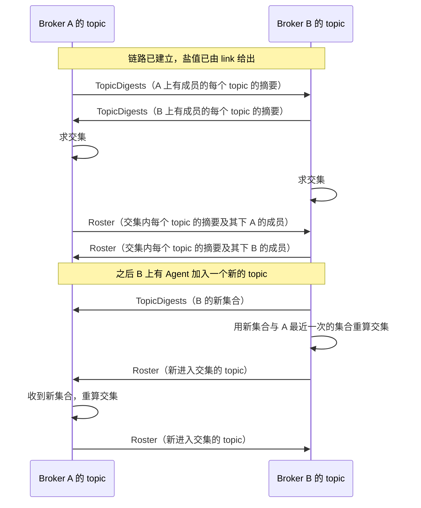

# topic

`topic` 记录哪个 Agent 在哪个 [topic](../../glossary.md) 里，并据此判定两个 Agent 是否可见。本机的成员关系来自 Agent 的加入与退出，对端的成员关系经链路交换得到，交换时只涉及双方都有成员的 topic。可以把它看作一张本机成员名单，加上每条链路各一张的对端成员名单。

## 核心概念

链路两端需要找出共同的 topic，又不能把自己独有的 topic 名字告诉对方。做法是各自对 topic 名加盐求摘要，只交换摘要（[ADR-salted-topic-digest](../../adr/adr-salted-topic-digest.md)）：摘要相同说明名字相同，摘要不同则对方无从得知名字。盐值由链路建立时双方各提供一半随机数拼成，每条链路、每次建立都不同。

每一方都持有本机当前有成员的 topic 的摘要集合，以及对端最近一次发来的摘要集合，这两个集合的交集就是共同的 topic。交集不由某一方算好后通知另一方，而是双方各算各的；任何一个集合变化，持有它的一方都重算，并把新进入交集的 topic 的成员名单发给对方。双方依据的是同样的一对集合，算出的交集最终相同。

## 职责

- 记录本机每个 Agent 所在的 topic，处理加入与退出，在 Agent 注销时清除其全部成员关系（`REQ-topics-001` 至 `REQ-topics-004`、`REQ-topics-022`）。
- 在每条链路上与对端交换加盐摘要，算出共同的 topic，只就这些 topic 发送本机的成员名单；名字相同的 topic 在两个 Broker 上摘要相同，因而是同一个 topic（`REQ-topics-007`、`REQ-topics-009`、`REQ-topics-014`）。
- 保存每条链路对端发来的成员名单，在链路断开时整体丢弃。
- 判定两个 Agent 是否可见（[ADR-topic-scoped-visibility](../../adr/adr-topic-scoped-visibility.md)，`REQ-topics-005`、`REQ-topics-006`）。
- 在本机成员关系或 Agent 的名字、曾用名、消歧标识、状态变化时，向相关链路推送变化（`REQ-agent-messaging-031`、`REQ-agent-messaging-032`）。

### 非职责

- 不决定默认 topic，由 [mcpserver](design-mcpserver.md) 计算后经 `broker` 调用加入。
- 不发布也不传播公开 topic 的声明，由 [directory](design-directory.md) 负责；加入时的公开声明由 [broker](design-broker.md) 先转交 `directory`，成功后再调用本包加入。本包中的 topic 都按不公开对待（`REQ-topics-008`）。
- 不把成员名单发往产生它的链路之外，系统中没有这样的转发（[ADR-direct-links-only](../../adr/adr-direct-links-only.md)）。
- 不读取配置，不拼 Agent 地址。别名与地址由 `broker` 处理。

## 外部接口契约

供 `broker` 调用，签名稳定。

```go
func Join(agent AgentID, name string) error
func Leave(agent AgentID, name string) error
func LeaveAll(agent AgentID)
func TopicsOf(agent AgentID) []string

// AgentChanged 在本机 Agent 的名字、曾用名、消歧标识或状态变化时由 broker 调用；
// 曾用名为空表示没有，或已过保留期。
func AgentChanged(agent AgentID, name, prevName, ref, status string)

// Visible 判定本机 Agent 与另一个 Agent 是否可见，并返回共同的 topic。
// other 可以是本机 Agent，也可以是某条链路上的远端 Agent。
func Visible(local AgentID, other AgentRef) (shared []string, ok bool)

// VisibleAgents 返回对 local 可见的全部 Agent 及各自的共同 topic。
func VisibleAgents(local AgentID) []VisibleAgent

// RemoteMembers 返回 peer 发来的、处在当前交集内的成员条目，供解析地址与核对发送方。
func RemoteMembers(peer Fingerprint) []Member
```

topic 名是长度不超过 256 字节的非空 UTF-8 字符串，不含控制字符，区分大小写。

## 依赖

`topic` 引用 `link`，用来收发自己的帧类型并订阅链路的建立与断开，不引用其他包，符合模块依赖图的方向。

## UML 图

下图是链路建立后的交换顺序。成员名单在摘要比对之后才发送，每一方只发送自己算出的交集内的 topic 的成员。图的后半段是一方的成员关系变化后的情形：变化的一方重发摘要并重算，另一方收到后也重算，双方各自补发新进入交集的 topic 的成员名单。



## 核心数据结构

| 结构 | 键 | 值 | 存续 |
|---|---|---|---|
| 本机成员名单 | topic 名 | 该 topic 下的本机 Agent 集合 | 随 Agent 存续 |
| 链路摘要表，每条链路一张 | 摘要 | 本机 topic 名 | 随链路存续 |
| 对端摘要集合，每条链路一个 | — | 对端最近一次发来的全部摘要 | 随链路存续 |
| 对端成员名单，每条链路一张 | 摘要 | 对端在该 topic 下的成员条目 | 随链路存续 |

成员条目的字段是名字、消歧标识、状态和曾用名，不含别名、工作目录或其他信息。曾用名由 Agent 所在的 Broker 在保留期满后清除，清除也作为一次变化推送，其他 Broker 因此能对以曾用名为目标的发送给出同样的提示。对端成员名单按摘要保存收到的全部条目，判定可见性和回答查询时只使用摘要处在当前交集内的条目。

链路上的帧：

| 帧 | 类别 | 内容 | 语义 |
|---|---|---|---|
| `TopicDigests` | 状态帧 | 摘要的完整集合 | 发送方当前有成员的全部 topic，覆盖此前发送的集合 |
| `Roster` | 状态帧 | 摘要，成员条目的完整列表 | 该 topic 下发送方的全部成员，覆盖此前的列表 |
| `RosterDelta` | 状态帧 | 摘要，新增、移除与变更的成员条目 | 增量 |

摘要的计算是 `SHA-256(盐值 ‖ topic 名)`，`‖` 表示拼接。

## 核心算法与流程

### 走查

Broker A 上 `api-worker` 在 topic `github.com/org/repo` 与 `secret-x`，Broker B 上 `frontend` 在 `github.com/org/repo`。链路建立。

| 步骤 | 事件 | A 持有的 B 成员名单 | B 持有的 A 成员名单 |
|---|---|---|---|
| 1 | A 发出自己的摘要集合，含 `github.com/org/repo` 与 `secret-x` 的摘要；B 发出的集合只含 `github.com/org/repo` 的摘要 | 空 | 空 |
| 2 | 双方求交集，都得到 `github.com/org/repo`；B 无法从另一个摘要得知 `secret-x` | 空 | 空 |
| 3 | A 发 `Roster`：`api-worker`；B 发 `Roster`：`frontend` | `github.com/org/repo`：`frontend` | `github.com/org/repo`：`api-worker` |
| 4 | `api-worker` 调用列出 Agent，看到 B 上的 `frontend` | 不变 | 不变 |
| 5 | B 上新 Agent `db-worker` 加入 `secret-x`。B 重发摘要集合，并用它与 A 此前发来的集合重算，`secret-x` 进入交集，B 发 `Roster(secret-x)`：`db-worker` | 增加 `secret-x`：`db-worker` | 不变 |
| 6 | A 收到 B 的新集合，重算，`secret-x` 进入交集，A 发 `Roster(secret-x)`：`api-worker` | 不变 | 增加 `secret-x`：`api-worker` |
| 7 | 链路断开 | 清空 | 清空 |

`db-worker` 加入之前，B 的任何输出中都没有 `secret-x` 这个名字。`db-worker` 加入时 A 并没有新的变化，A 的成员名单之所以能到达 B，是因为 A 在收到对端的新集合时重算了交集。

### 交集的重算

下列任一事件发生时，本 Broker 对相关的链路重算交集：

- 本机某个 topic 从无成员变为有成员，或从有成员变为无成员。此时先向每条已建立的链路重发 `TopicDigests`。
- 收到对端的 `TopicDigests`。

重算后，对新进入交集的 topic 发送 `Roster`；离开交集的 topic 不再用于判定，其条目留在对端成员名单中直到被覆盖或链路断开。交集内的 topic 下成员增减，或成员条目的任何字段变化时发送 `RosterDelta`。

链路上的这些帧由 `link` 按到达顺序串行交给本包处理。本包在持有自己的锁时取快照并交给 `link` 的发送队列，一次事件产生的全部帧在同一次持锁内入队，因此在同一条链路上，后取的快照后发出，`Roster` 不会被更早取得的内容覆盖。

### 可见性判定

本机 Agent `x` 与另一个 Agent `y` 可见，当且仅当存在一个 topic，`x` 在本机成员名单的该 topic 下，且 `y` 也在该 topic 下：`y` 是本机 Agent 时查本机成员名单，`y` 是远端 Agent 时查其所在链路的对端成员名单中处在交集内的条目。判定的开销与 `x` 所在的 topic 数成正比。

## 错误与失败语义

加入一个已加入的 topic、退出一个未加入的 topic 都返回成功，结果是幂等的。topic 名不合法时返回 `invalid_argument`。对端发来的 `Roster` 或 `RosterDelta` 的摘要不在对端最近一次的摘要集合中时，该帧无效，丢弃并记录日志，这表示对端的实现有误。

链路断开时该链路的摘要表、对端摘要集合与对端成员名单全部丢弃，远端 Agent 随之不可见；链路重建后盐值不同，从 `TopicDigests` 重新开始。

## 并发与事务边界

本机成员名单与各链路的表由同一把读写锁保护。取快照与把帧交给 `link` 的发送队列在持锁时完成，入队不等待网络；帧的实际发送由 `link` 的写协程在锁外进行。`TopicDigests` 与 `Roster` 的覆盖语义加上帧的有序处理，使任意时刻的并发变化最终收敛到双方的当前状态。

## 扩展点

对端成员名单的来源是一个扩展点，为与使用其他协议的 Agent 互通而预留。现有的来源只有一种：链路上以 `TopicDigests`、`Roster` 与 `RosterDelta` 交换的成员名单。可见性判定只依赖对端成员名单的内容，不依赖它的来源。

## 实现状态

| 能力 | 状态 | 代码 |
|---|---|---|
| 加入、退出与注销清理 | 未实现 | — |
| 摘要交换与交集的重算 | 未实现 | — |
| 成员名单的全量与增量同步 | 未实现 | — |
| 可见性判定 | 未实现 | — |
