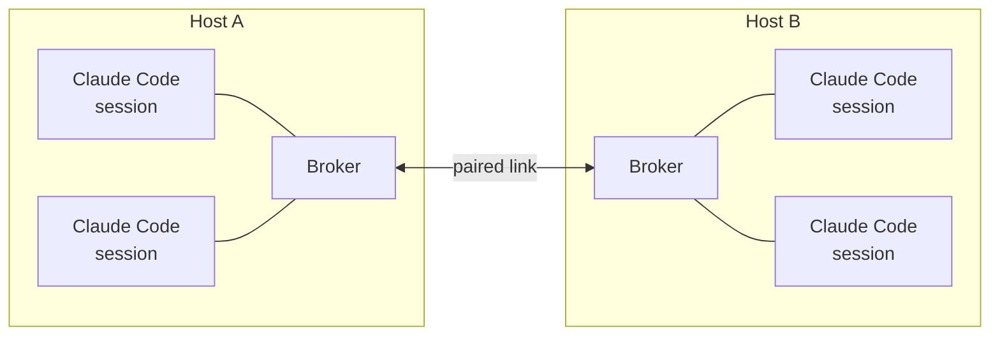

## What it solves

Claude Code's built-in cross-session messaging reaches sessions on one host. `peers` extends the same idea across hosts: sessions on different hosts discover each other and exchange plain-text messages.

## How it works

Each host runs a Broker, a daemon that registers the agent sessions on that host and keeps its links to other Brokers. A session enables the `peers` tools and registers with its local Broker, which makes it an agent. Two users pair their Brokers with a pairing key. After that, agents on both sides that share at least one topic can see each other and send messages. A message that arrives for a session is written into that session's inbox socket. An idle session starts working on it without user input.

Sessions on the same host can also use the tools to message each other. The path is the same, with both sessions registered on one Broker.

## Platform requirements

`peers` runs on macOS and Linux, on amd64 and arm64. Native Windows is not supported.

Claude Code v2.1.224 or later is required. See [known limitations]() for how `peers` depends on Claude Code.

## Next steps

To learn the vocabulary, continue with [Concepts](). To set up a host, see the [Guides](); the [Reference]() lists tools, commands and configuration keys.
