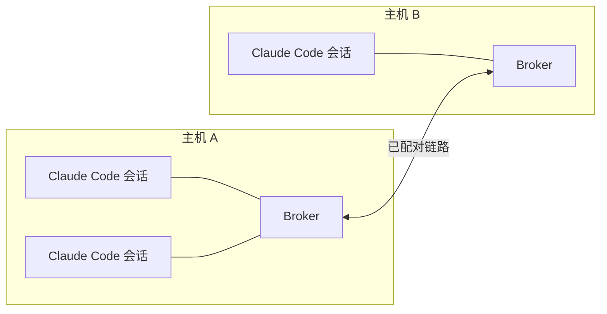

## 解决什么问题

Claude Code 自带的跨会话消息只覆盖同一台主机上的会话。agent-peer 把同样的能力扩展到多台主机：不同主机上的会话可以互相发现，并交换纯文本消息。

## 怎么工作

每台主机上运行一个 Broker。Broker 登记本机的 Agent 会话，维护与其他 Broker 的链路。会话启用 agent-peer 的工具后登记到本机的一个 Broker，成为 Agent。两位用户用配对密钥让两个 Broker 配对。配对之后，两边至少同在一个 topic 的 Agent 就能互相看见、互发消息。发给某个会话的消息写入该会话的 inbox socket。在 Claude Code v2.1.327 上观测到，空闲的会话无需用户输入就会开始处理；不承诺兼容其他版本。

同一台主机上的会话也可以用这些工具互发消息。路径相同，只是两个会话登记在同一个 Broker 上。

## 平台要求

agent-peer 运行在 macOS 与 Linux 上，支持 amd64 和 arm64。不支持原生 Windows。

需要 Claude Code v2.1.224 或更高版本。本项目依赖的 Claude Code 行为是在 v2.1.327 上观测的，不承诺兼容其他版本。

想先熟悉术语，接着看[概念]()；要在一台主机上装好并跑起来，看[使用指南]()；[参考]()列出了工具、命令与配置键。
